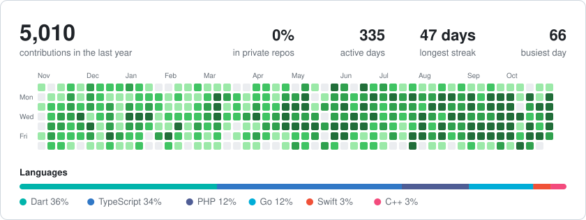

### Hi, I'm Yunus Emre 👋

Lead backend developer at [**Midas**](https://midas.gs) in Istanbul. I build the parts that have to work: payments, KYC, live-ops, push, and the data pipelines behind mobile games.

Mostly **Go**, **TypeScript** and **Postgres** on the server, **Flutter** when something needs a screen.

 

#### Things I've shipped

**[virtual-camera](https://github.com/yecandir/virtual-camera)** · Chrome extension + macOS app  
Play a video as your webcam in Google Meet and Teams, record clips, switch sources live mid-call. [On the Chrome Web Store →](https://chromewebstore.google.com/detail/virtual-camera/dbcjpbaaghjopnbeinpjdhangilehlce)

**[duel-gaming](https://github.com/yecandir/duel-gaming)** · Flutter + Supabase  
Head-to-head mini games over an invite link. Each game is a pure reducer; an Edge Function runs the authoritative move so clients can't cheat.

**[hardhat-gui](https://github.com/yecandir/hardhat-gui)** · Hardhat plugin  
One-click GUI to call and test your deployed contracts from a wallet.

**[grpc-api](https://github.com/yecandir/grpc-api)** · Go  
Proto-first gRPC services with generated clients and a Makefile that handles the codegen.

 

#### Right now

Building **karya**, a git-versioned second brain that an agent looks after: it captures, links and prunes notes. Markdown goes in, answers come out.

 

<picture>
  <source media="(prefers-color-scheme: dark)" srcset="assets/card-dark.svg" />
  
</picture>

Almost all of my work is in private repos, so the card counts those too. It's rebuilt every night by [a small script](scripts/render_card.py) in this repo.

 

[yemrecandir@gmail.com](mailto:yemrecandir@gmail.com)
